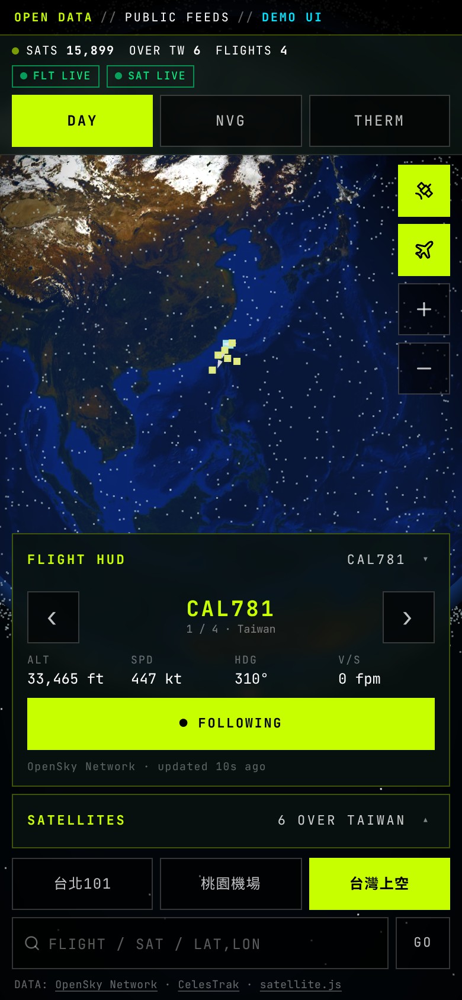

# God's Eye View // ORB-7 — 作品集案例介紹

> **一句話介紹：** 手機優先的 3D 地球儀，把台灣周邊的真實航班與約 15,900 顆真實衛星，用純前端、零後端、免 API key 的方式即時畫在你的手機上。

* 🔗 **線上 Demo：** <https://numenaslan-cell.github.io/gods-eye-mobile/>
* 💻 **原始碼：** <https://github.com/numenaslan-cell/gods-eye-mobile>

## 想法與要解決的問題

公開的航班與衛星資料很多，但多半是原始 JSON／TLE 文字，一般人看不懂，也很難在手機上順暢瀏覽。這個專案想回答一個問題：**能不能只用公開資料與瀏覽器，做出一個「打開網址就能看、手機單手能操作」的即時資料視覺化？**

做法是把 OpenSky Network 的航班、CelesTrak 的衛星軌道資料，結合 three.js 3D 地球，做成像儀表板一樣的介面；資料抓不到時也不會變成空白畫面，而是明確標示並改用示範資料。

> 介面風格是虛構的「諜報儀表板」，僅為展示用途；使用的皆為公開資料，不代表任何真實監控系統。

## 主要功能

* 🌐 **手機優先的 3D 地球儀**（three.js）：日間 `DAY`／夜視 `NVG`／熱像 `THERM` 三種顯示模式，晝夜交界線依現在時間計算
* ✈️ **台灣周邊即時航班**（OpenSky，範圍 21.5–26.5°N、119–123°E）：透過**自己部署的 Cloudflare Worker 代理**取得資料，每 15 秒更新，兩次更新之間依航向與速度平滑推算位置；Flight HUD 顯示呼號、高度、速度、航向、升降率，可跟隨單一航班
* 🛰️ **約 15,900 顆真實衛星**（CelesTrak TLE，實測 `active` 群組 15,899 顆）：用 satellite.js (SGP4) 在瀏覽器內每 5 秒推算位置，不需後端
* 📍 **台灣上空衛星清單 ＋ ISS 追蹤**：一鍵追蹤國際太空站
* 🔎 搜尋呼號、衛星名稱或座標；快速定位台北 101、桃園機場、台灣上空
* 📲 **PWA 可安裝**：manifest、圖示、Service Worker（只快取靜態檔，資料一律走網路），可加入主畫面
* 🧯 **優雅的 Demo 退路**：CORS 被擋、斷網、逾時、HTTP 429 時，顯示橘色 **DEMO DATA** 徽章並改用示範資料，之後自動退避重試

## 技術堆疊

* 前端：JavaScript、React 18、three.js（3D 地球與自訂 shader）、手寫的行動優先 CSS
* 軌道運算：satellite.js 6.0.2（SGP4）
* 資料：OpenSky Network REST API、CelesTrak TLE
* 邊緣代理：Cloudflare Workers（免費方案）
* 部署：GitHub Pages（純靜態、相對路徑）；PWA（manifest ＋ Service Worker）
* 貼圖：NASA Blue Marble／Black Marble

## 解決的技術難題

1. **CORS 與資料代理**：OpenSky 不保證對第三方網站開放 CORS，直接從 GitHub Pages 呼叫可能被瀏覽器擋下。我寫了一支 Cloudflare Worker 代理：只轉發 `/api/states/all`、加上 CORS 標頭、**只允許本站與 localhost 來源**，並快取 10 秒，讓多位訪客共用一次上游請求。
2. **限流與退避**：OpenSky 匿名每日額度有限（文件記載約 400 credits）。程式遇到錯誤時以 60 秒起、指數退避、上限 10 分鐘重試；遇到 429 則優先採用伺服器回傳的 `X-Rate-Limit-Retry-After-Seconds`。
3. **TLE 快取**：`active` 群組約 2.7 MB，短時間重複下載甚至會被擋（開發時實測遇過 HTTP 403）。因此把 TLE 快取在 localStorage 2 小時，失敗時退回舊快取或較小的 `stations` 群組，最後才用示範資料。
4. **手機版面與 safe-area**：375–430 px 直式不橫向捲動、按鈕 ≥ 44 px、HUD 面板可收合（手機上一次只展開一個），並處理瀏海與 Home 指示條的 `safe-area-inset`。
5. **真實經緯度貼圖**：使用 NASA 地球貼圖，經緯度與球面座標的轉換和貼圖對齊，讓航班、衛星與台灣上空範圍落在正確位置；貼圖以 data URI 內嵌，連 `file://` 開啟也能顯示。

## 我可以幫你做什麼

* 📊 **客製化即時資料儀表板**：串接你的 API／公開資料，做成可在手機與桌機閱讀的即時儀表板
* 🗺️ **地圖／3D 地球視覺化**：地理資料、軌跡、移動物件的互動式呈現
* 📱 **行動優先網頁 App（PWA）**：可安裝、斷線時有退路、版面適應各種手機螢幕
* ☁️ **輕量後端／邊緣代理**：用 Cloudflare Workers 處理 CORS、快取與限流問題

GitHub：[numenaslan-cell](https://github.com/numenaslan-cell)

---

# English Version

**God's Eye View // ORB-7** — a mobile-first 3D globe that renders real flights around Taiwan and ~15,900 real satellites in the browser: pure front-end, no backend, no API keys.

* **Live demo:** <https://numenaslan-cell.github.io/gods-eye-mobile/>
* **Source:** <https://github.com/numenaslan-cell/gods-eye-mobile>

### Idea
Public flight and satellite data is abundant but raw and hard to explore on a phone. This project turns OpenSky and CelesTrak open data into an interactive, dashboard-style 3D globe that works from a plain URL, and degrades gracefully (clearly labelled demo data) when a feed is unavailable. The "spy dashboard" styling is fictional and for demonstration only.

### Features
* Mobile-first three.js globe with **DAY / NVG / THERM** modes and a day–night terminator computed from the current time
* **Real-time OpenSky flights** over Taiwan (21.5–26.5°N, 119–123°E) via **my own Cloudflare Worker proxy**; 15 s refresh with dead-reckoned movement in between; flight HUD (callsign, altitude, speed, heading, vertical rate) with follow mode
* **~15,900 real satellites** from CelesTrak TLEs (15,899 in the `active` group when tested), propagated in-browser with satellite.js (SGP4) every 5 s
* **Satellites currently over Taiwan** and one-tap **ISS tracking**; search by callsign, satellite name or coordinates
* **Installable PWA** (manifest + static-only service worker)
* **Graceful demo fallback** with a visible DEMO DATA badge and automatic retry

### Tech stack
JavaScript, React 18, three.js, satellite.js 6.0.2, hand-written mobile-first CSS, Cloudflare Workers (free tier), GitHub Pages, PWA; data from OpenSky Network and CelesTrak; NASA Blue/Black Marble textures.

### Technical challenges solved
1. **CORS proxy** — a small Cloudflare Worker forwards only `/api/states/all`, adds CORS headers, allows only the site's origin and localhost, and caches for 10 s so visitors share one upstream request.
2. **Rate-limit backoff** — exponential retry from 60 s up to 10 min; on HTTP 429 it honours the server's `X-Rate-Limit-Retry-After-Seconds`.
3. **TLE caching** — the ~2.7 MB `active` set is cached in localStorage for 2 h, with fallback to stale cache, then the smaller `stations` group, then demo data.
4. **Mobile layout** — 375–430 px portrait without horizontal scroll, ≥ 44 px touch targets, collapsible HUD panels, notch/home-indicator safe areas.
5. **Real lat/lon textures** — NASA Earth textures with a lat/lon → sphere mapping aligned to them, embedded as data URIs so even `file://` works.

### What I can build for you
* Custom **real-time dashboards** on top of your APIs or open data
* **Map and 3D globe visualizations** of geospatial and moving-object data
* **Mobile-first web apps / PWAs**
* Lightweight **edge proxies** (Cloudflare Workers) for CORS, caching and rate limits

GitHub: [numenaslan-cell](https://github.com/numenaslan-cell)

---

# 短版自我介紹（104／Tasker／LinkedIn）

資料視覺化接案｜自製手機優先 3D 地球儀，即時呈現台灣周邊航班與約 1.59 萬顆真實衛星，純前端、可安裝成 PWA。可承接即時資料儀表板、地圖／3D 視覺化與行動網頁 App。Demo：numenaslan-cell.github.io/gods-eye-mobile
