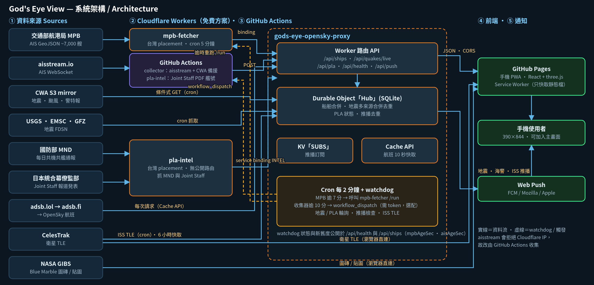
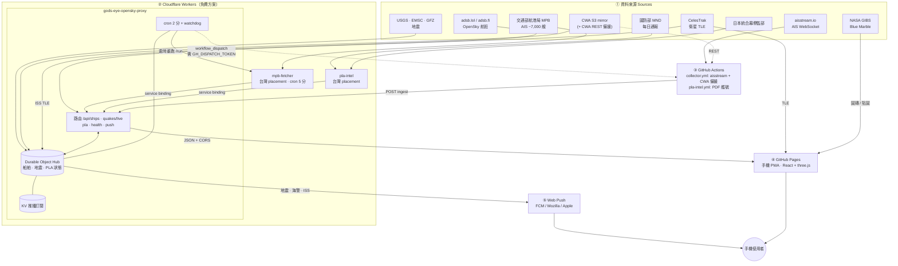

# God's Eye View // ORB-7 🌍🛰️

手機優先的「上帝視角」台灣周邊即時資料地球儀：航班、船舶（AIS）、地震／颱風／警特報、共機日報、衛星與 ISS 過境預測，並支援 Web Push 提醒；放大時自動疊加 NASA GIBS 高解析圖磚，飛機／船隻以不同剪影一眼分辨，疑似海警／共軍艦／共機有「⚠️ 疑似」警示標籤（啟發式，非官方辨識）。
前端是純靜態網頁（GitHub Pages，瀏覽器端不需要任何 API key）；後端只有一支免費方案的 Cloudflare Worker（CORS 代理、資料合併、推播），以及一支跑在一般網路 IP 的資料收集器（見 [`proxy/DEPLOY.md`](proxy/DEPLOY.md)）。
資料來自**公開資料源**：adsb.lol／adsb.fi／OpenSky（航班）、交通部航港局 MPB＋aisstream（船舶）、中央氣象署／USGS（地震）、第三方整理的國防部日報（PLA）、海巡署 RSS、CelesTrak（衛星）；抓不到時會顯示明顯的橘色 **DEMO DATA** 徽章並改用示範資料。各來源的授權與限制見 [`docs/DATA-SOURCES.md`](docs/DATA-SOURCES.md)。


> ⚠️ 這是一個**展示／學習用**專案：介面風格是虛構的「諜報儀表板」，但**沒有任何機密資料**，也不代表任何真實監控系統。
> 原本畫面上的 `TOP SECRET // NOFORN` 字樣已改為 `OPEN DATA // PUBLIC FEEDS // DEMO UI`。
> 航班與衛星資料為公開、非即時保證（延遲／缺漏／被限流都可能發生），**請勿用於導航或任何安全相關用途**。

## 功能

* 🌐 3D 地球（three.js）：日間 / 夜視 (NVG) / 熱像 (THERM) 三種顯示模式，晝夜交界線依「現在時間」計算
* 🔍 **放大不再模糊（LOD）**：鏡頭拉近時，在內嵌的 4096 px 底圖上疊加 [NASA GIBS](https://earthdata.nasa.gov/gibs) WMTS 高解析圖磚（日間／熱像：`BlueMarble_ShadedRelief_Bathymetry`，夜間／夜視：`VIIRS_CityLights_2012`，z4–z7，最近約 490 m/px）；同時最多 18 塊、LRU 快取並釋放貼圖；renderer 使用 `devicePixelRatio`（上限 3，幀時間過長時自動降到 2／1.5）、各向異性過濾與 mipmap。圖磚來源已於頁尾與 `docs/DATA-SOURCES.md` 標示
* ✈️ **台灣周邊真實航班**（[adsb.lol](https://adsb.lol)〔ODbL〕為主、[adsb.fi](https://adsb.fi) 備援、OpenSky 最後手段，由 Worker `/api/flights` 合併，範圍 21.5–26.5°N、119–123°E）：顯示即時架數；Flight HUD 可 ‹ › 切換航班，顯示呼號、高度 (ft)、速度 (kt)、航向、升降率，並可「FOLLOW」跟隨；每 15 秒更新，兩次更新之間依航向與速度平滑推算
* 🔺 **飛機與船隻圖示一眼分辨**：航空器為「機頭朝航向」的飛機剪影，船舶為「船艏朝航向」的船殼＋船艛剪影（依貨輪／油輪／客輪／漁船／其他上色）；皆為向量網格、以固定螢幕像素大小繪製（DPR 3 下依然銳利），近距離會隱藏靜止的小漁船以免蓋住島嶼；圖例同步更新
* 🛰️ **真實衛星**（CelesTrak TLE + satellite.js SGP4）：顯示衛星總數、**台灣上空的衛星清單**、ISS 即時位置（可一鍵追蹤）
* 🌏 **地震圖層 + QUAKES 面板（多來源即時合併）**：中央氣象署（含小規模有感地震，最權威）＋ USGS ＋ EMSC ＋ GFZ，Worker 每 2 分鐘抓取並依「時間 ±150 秒、位置 ±1.5°」去重，同一事件以氣象署為準，**每筆標示來源**（如 CWA·USGS·EMSC，並列各機構規模）；近 30 天 M3.0+、依規模大小的脈動圓環標記（24 小時內較亮較快），清單列出時間／規模／深度／地點／來源，點選會飛到震央。颱風與警特報同樣由氣象署公開資料取得
* 🚢 **台灣周邊船舶 (AIS)**：船形標記（依貨輪／油輪／客輪／漁船／其他／疑似海警上色，與白色飛機標記明顯不同）、「在畫面內 N 艘」計數、‹ › 切換或直接點選船隻、船名／MMSI／船型／航速 (kn)／航向／目的地、FOLLOW 跟隨；資料來源為 aisstream.io 與交通部航港局（MPB）臺灣海域 AIS，由收集器低頻率取得並經自己的 Cloudflare Worker 以 MMSI 合併（API key 只存在 Worker secret）；CCG 標記為名稱／船型啟發式（排除漁船型別 30 的純 MMSI 前綴比對），沒有 key 或失敗時顯示 **DEMO DATA**
* 🛰️ **過境預測 (Passes)**：用瀏覽器定位（預設台北，也可手動輸入經緯度）預測未來 72 小時 ISS、天宮 (CSS) 與數顆亮星（HST、AJISAI、TERRA、AQUA、ENVISAT、ALOS）的過境：起／峰／止時間、最高仰角、起訖方位、是否「可能看得到」（衛星受日照且天色夠暗）；「LOOK HERE」羅盤會指出現在該看的方位與仰角，可選用手機羅盤；頁面開著時可在過境前 5 分鐘通知
* 🕒 **資料新鮮度**：船舶（交通部航港局）、地震、PLA 面板顯示「資料更新於 N 分鐘前」；船位超過 10 分鐘（地震 10 分、PLA 抓取 60–90 分）轉為琥珀色。aisstream 補充來源另列一行（GitHub Actions 排程不穩，延遲屬正常，不影響主資料）。
* 🎯 **辨識信心**：疑似海警／共軍艦／共機標示「**確認**（國防部／日本統合幕僚監部官方資料）／**高信心**（多項獨立訊號）／**推測**（僅單一規則：MMSI 413875、ICAO 0x7A1000–0x7A4FFF、政府船舶推論）」，並附圖例。
* 🛡️ **PLA 分頁**：**國防部（MND）每日「中共解放軍臺海周邊海、空域動態」官方數字**（共機架次、進入西南／東部空域架次、共艦、**公務船**，附航跡示意圖連結與近 7 日長條圖；由放在台灣的 `pla-intel` Worker 抓取，Worker `/api/pla`）＋ **日本防衛省統合幕僚監部**發布的中國軍艦／軍機動向（級別、艦號→艦名、海峽與航向、機型；PDL 1.0，標示出典與「加工」）＋ 第三方 7 日趨勢 ＋ 海巡署新聞中提到「海警」的項目（Worker `/api/cga`，30 分鐘快取）。分頁明確標示：**國防部（MND）每日公布的架次／艦數才是權威數字**，地圖上的疑似標記只是少數有發送 ADS-B／AIS 的子集，不是計數
* ⚠️ **疑似警示標籤（啟發式，非辨識）**：疑似海警船「⚠️ 疑似海警」、疑似解放軍海軍艦「⚠️ 疑似共軍」（名稱含 海軍／PLA NAVY／PLAN＋艦號，或 MMSI 412/413 且船型 35；漁船不會只靠 MMSI 被標記）、疑似共機「⚠️ 疑似共機」（adsb.lol/adsb.fi 軍用旗標＋中國 ICAO 位址區段／PLA 機型（含 TU16＝轟-6）或呼號；ICAO 位址落在 0x7A1000–0x7A4FFF 這段幾乎全是軍機的區段也會標；單靠一般中國位址不標記）。海警判斷增加：MMSI 413875xxx 區段、曾以海警船名出現過的 MMSI（KV 記憶）、船名內的艦號→所屬分局（如 14530→福建）；只有「船型 55」而無其他證據的船改標為較保守的「政府船舶」（例如 XIA MEN HAI YANG 01），不再稱海警。標籤永遠顯示並有脈動圈；多數共機／共艦不發 ADS-B／AIS，這些標記只是提示
* 🔔 **Web Push 提醒（頁面關閉也會收到）**：台灣周邊 M4.5+ 地震（多來源去重，同一地震只推一次）、AIS 出現疑似中國海警船、ISS 過境前約 5 分鐘（依訂閱者位置）；每種提醒可分別開關
* 🔎 搜尋：輸入呼號（如 `CAL`）、船名或 9 位 MMSI、衛星名稱（如 `STARLINK`、`ISS`）或座標（`25.03,121.56`）
* 📍 快速定位：台北101、桃園機場、台灣上空
* 📱 手機優先：375–430 px 直式不會橫向捲動、所有按鈕 ≥ 44 px、HUD 面板可收合（手機上一次只展開一個）、支援瀏海／Home 指示條 safe-area
* 📲 PWA：`manifest.json`、`theme-color`、`apple-mobile-web-app-*`、圖示，可「加入主畫面」；Service Worker 只快取靜態檔，資料 API 一律走網路
* 🧯 容錯：CORS 被擋、網路錯誤、逾時、HTTP 429 都會優雅降級（徽章 + 說明 + 退避重試），衛星 TLE 本地快取 2 小時

## 系統架構 Architecture

資料來源（MPB、aisstream、CWA S3、USGS/EMSC/GFZ、國防部 MND、日本統合幕僚監部、adsb.lol、CelesTrak、NASA）→ Cloudflare Workers（`mpb-fetcher`、`pla-intel`、`gods-eye-opensky-proxy` ＋ Durable Object ＋ cron watchdog）→ GitHub Pages 手機 PWA，並由 Worker 發送 Web Push。GitHub Actions 負責 aisstream（會拒絕 Cloudflare IP）與 CWA REST 備援、Joint Staff PDF 艦號。



<details><summary>Mermaid 原始碼（GitHub 會直接渲染）</summary>



</details>

> 圖檔：`docs/architecture.png` / `docs/architecture.svg`（手工排版，產生器見 `scripts/gen-architecture.py`）；Mermaid 原始檔 `docs/architecture.mmd`。同一張圖也在網站「更新內容」分頁裡。

## 如何執行

最簡單：用任何靜態伺服器開啟 `index.html`。

```bash
cd gods-eye-mobile
python3 -m http.server 8000      # 或 npx serve .
# 開啟 http://localhost:8000
```

也可以直接雙擊 `index.html`（`file://`）：畫面、貼圖、示範資料都能運作，但瀏覽器可能因為 `file://` 的 origin 為 `null` 而擋掉部分資料請求，此時會顯示 DEMO DATA。

網址參數：`?demo=1` 強制使用示範資料；`?sats=stations` 只載入小型衛星群組（省流量）；`?opensky=https://你的-worker.workers.dev/api` 指定自己的 OpenSky 代理。

### 設定

編輯 `assets/config.js`（不需重新建置）：`openskyBase`、台灣範圍 `bbox`、`flightRefreshMs`、`satGroup`、`satRefreshMs`、`tleCacheMs`、`demoFallback`。

## ⚠️ 關於 OpenSky 與 CORS（請務必閱讀）

* **CelesTrak**：實測 `access-control-allow-origin: *`，瀏覽器可直接呼叫。✅
* **OpenSky**：官方並未承諾對第三方網站開放 CORS，多數情況在 GitHub Pages 上直接呼叫會被瀏覽器擋下（此時 App 自動顯示 DEMO DATA）。匿名使用者每天只有 **400 credits**（本範圍每次 1 credit），15 秒更新約 100 分鐘就用完，之後會 429。
* **建議做法**：部署 [`proxy/cloudflare-worker.js`](proxy/cloudflare-worker.js)（Cloudflare Workers 免費方案即可，加 CORS 標頭並快取 10 秒），然後把 `assets/config.js` 的 `openskyBase` 改成 `https://<你的 worker>.workers.dev/api`。
* 完整測試記錄見 [`docs/DATA-SOURCES.md`](docs/DATA-SOURCES.md)（開發沙盒連不上 OpenSky，所以該端點的即時回應未能親自驗證；開發時用模擬回應測試了解析與 UI）。

## 部署到 GitHub Pages

1. 建立 GitHub repo，把此資料夾內容推上去（`index.html` 在根目錄）。
2. 到 **Settings → Pages**，Source 選 *Deploy from a branch*，Branch 選 `main` / `(root)`。
3. 幾分鐘後即可在 `https://<你的帳號>.github.io/<repo>/` 開啟；手機用 Safari「分享 → 加入主畫面」或 Chrome「安裝應用程式」。
4. 所有路徑皆為相對路徑，子路徑部署不需額外設定。

## 專案結構

```
index.html              入口（viewport / PWA meta）
manifest.json, sw.js    PWA
assets/styles.css       手寫的行動優先樣式（取代原本的 Tailwind 編譯檔）
assets/config.js        執行期設定
assets/live-data.js     OpenSky + CelesTrak 資料層（含 DEMO 退路）
assets/app.bundle.js    ← build.mjs 產生：React + three.js（原 artifact 的 bundle）+ src/app.js
assets/textures.js      ← build.mjs 產生：把 assets/textures/*.jpg 內嵌成 data URI（讓 file:// 也能用）
assets/textures/        NASA Blue Marble / Black Marble 貼圖
assets/vendor/          satellite.js 6.0.2（MIT）
src/vendor.js           從原 artifact 抽出的 React / three.js / lucide 壓縮碼
src/app.js              可讀的應用程式原始碼（已重寫）
proxy/                  Cloudflare Worker：航班（adsb.lol → adsb.fi → OpenSky）、OpenSky CORS 代理、AIS 船舶中繼、Web Push（src/ 原始碼、dist/ 部署檔、DEPLOY.md）
assets/passes.js        衛星過境預測核心（瀏覽器與 Worker 共用）
assets/push.js          Web Push 前端
scripts/gen-vapid.mjs   產生 VAPID 金鑰
```

修改 `src/app.js` 後執行 `node build.mjs`（無需 npm 套件）重新產生 `assets/app.bundle.js`。

### 關於「原始碼還原」

原本是已打包的 React artifact（單一 HTML）。React／three.js 的原始碼無法乾淨還原（已壓縮、變數名被改寫），所以保留 `src/vendor.js` 這份打包碼；但應用程式本身（約 800 行）已改寫成可讀的 `src/app.js`，並移除了 artifact 平台注入的 `window.parent.postMessage` 程式、`/fonts/...` 絕對路徑字型與 Google Fonts `@import`（改用系統等寬字型）。

## 致謝 / Credits

* 地震／颱風／警特報：[交通部中央氣象署開放資料](https://opendata.cwa.gov.tw/)——Worker 直接讀取氣象署公開的 AWS S3 鏡像（`s3://cwaopendata`，不需 key；政府資料開放授權條款第 1 版，標示「資料來源：交通部中央氣象署」）；另合併 [USGS](https://earthquake.usgs.gov)（公有領域）、[EMSC-CSEM](https://www.seismicportal.eu)（CC BY 4.0）、[GFZ GEOFON](https://geofon.gfz.de)（CC BY 4.0）。GitHub Actions 以 CWA REST API（`CWA_API_KEY`）持續回報作為備援
* 共軍動態（官方）：[國防部「中共解放軍臺海周邊海、空域動態」](https://www.mnd.gov.tw/news/plaactlist)；[防衛省・統合幕僚監部 報道発表資料](https://www.mod.go.jp/js/)（公共データ利用規約 第1.0版 PDL 1.0；本 App 擷取並加工整理，非官方背書）
* 共軍動態日報趨勢：[pla-tracker.skyfaring.net](https://pla-tracker.skyfaring.net)（第三方整理，資料源自國防部每日公布，非官方）；海警相關新聞：[海洋委員會海巡署](https://www.cga.gov.tw) 新聞 RSS（僅限非商業使用）
* 船舶資料：[aisstream.io](https://aisstream.io) ＋ [交通部航港局](https://mpbais.motcmpb.gov.tw/aismpb/)「臺灣海域船舶即時資訊系統」（未公開文件的端點、無公開授權條款；僅低頻率輪詢，僅供展示用途）
* 航班資料：[adsb.lol](https://adsb.lol)（© adsb.lol contributors，ODbL 1.0）、[adsb.fi](https://adsb.fi) Open Data（僅限非商業）、[OpenSky Network](https://opensky-network.org)（Schäfer et al., IPSN 2014）
* 衛星軌道資料：[CelesTrak](https://celestrak.org)（Dr. T.S. Kelso）
* SGP4：[satellite.js](https://github.com/shashwatak/satellite-js)（MIT）
* 地球貼圖：NASA Earth Observatory — Blue Marble Next Generation、Black Marble；放大時的高解析圖磚：NASA GIBS（BlueMarble_ShadedRelief_Bathymetry、VIIRS_CityLights_2012），詳見 docs/DATA-SOURCES.md
* [three.js](https://threejs.org)、[React](https://react.dev)、[lucide](https://lucide.dev)（皆 MIT）

## 隱私說明 Privacy

本站使用 [Cloudflare Web Analytics](https://www.cloudflare.com/web-analytics/) 取得匿名的訪客統計（頁面瀏覽數、來源網站、國家、瀏覽器與頁面載入效能）。此統計**不使用 Cookie、不做指紋辨識，也不跨站追蹤個別使用者**。統計資料僅作者可見，用於了解使用情形；若不想被統計，可用瀏覽器的內容阻擋器封鎖 `static.cloudflareinsights.com`。

*English: this site uses Cloudflare Web Analytics for anonymous, cookie-free visitor statistics (page views, referrers, country, browser, load performance). No cookies are used and individual users are not tracked across sites. You can block `static.cloudflareinsights.com` with a content blocker to opt out.*

## 授權

MIT © 2026 messiah — 見 [LICENSE](LICENSE)。第三方資料與素材請遵守各自條款。

---

## English summary

**God's Eye View // ORB-7** is a mobile-first 3D globe of **real public data** around Taiwan: flights (adsb.lol → adsb.fi → OpenSky), ships (Taiwan MPB + aisstream, with a suspected-China-Coast-Guard heuristic), earthquakes / typhoon / warnings (CWA with USGS fallback), PLA daily stats and CGA 海警 news, satellites and ISS pass predictions (CelesTrak + satellite.js), plus Web Push alerts. When you zoom in, NASA GIBS high-resolution tiles are overlaid on the base texture (LOD, adaptive device-pixel-ratio); aircraft and ships use different silhouettes oriented by heading / course; and suspected China Coast Guard ships, suspected PLA Navy ships and suspected PLA aircraft get always-visible "⚠️ 疑似" warning labels — heuristics on public ADS-B / AIS fields, not identifications (most PLA aircraft and ships don't broadcast; the PLA tab states that the MND daily count is the authoritative number). The front end is a static page; the backend is one free-plan Cloudflare Worker (CORS proxy, merging, Durable Object, cron, push) and a small collector script on a normal-IP machine (needed because aisstream and CWA block Cloudflare IPs). It has DAY / NVG / THERM modes, search, camera follow, safe-area aware responsive layout, and PWA basics.

* **Run:** serve the folder with any static server (`python3 -m http.server`) and open `index.html`; no build or browser-side API key needed (the live feeds come from the deployed Worker, see `proxy/DEPLOY.md`). `node build.mjs` only if you edit `src/app.js`.
* **Deploy:** push to GitHub, enable *Settings → Pages → main / root*. All paths are relative.
* **Data caveats:** every feed has its own terms (adsb.fi and the CGA RSS are non-commercial; the MPB endpoint is undocumented; the PLA trend line is a third-party compilation; the PLA tab now shows the official Taiwan MND daily bulletin and Japan Joint Staff releases (PDL 1.0, attributed and marked as processed), scraped by a Taiwan-placed Worker, see `workers/pla-intel/`) — see `docs/DATA-SOURCES.md`. If a feed fails (CORS, 429, timeout) the UI falls back to another source or shows an amber **DEMO DATA** badge with generated placeholder data.
* **Collector (GitHub Actions + placed Worker):** `.github/workflows/collector.yml` runs on a `*/5 * * * *` cron (plus manual `workflow_dispatch`) in two steps: (1) `POST` to the **`mpb-fetcher`** Worker (`workers/mpb-fetcher/`, `placement.region = "gcp:asia-east1"`) which fetches Taiwan MPB AIS (~7,000 ships), trims it and ingests it into the main Worker through a service binding — MPB only answers from Taiwan-routed networks, so GitHub runners and ordinary Workers time out, but a Worker placed near Taiwan works; (2) `scripts/collect-once.mjs` with `MPB=0` for one CWA fetch + ~60 s of aisstream, then a freshness check against `/api/ships` (`updated`) and `/api/quakes` (`time`). Repo secrets: `INGEST_TOKEN` / `CWA_API_KEY` / `AISSTREAM_API_KEY` / `WORKER_URL`. The run fails (red + e-mail) on a non-2xx / 0-ship answer from `mpb-fetcher`, `mpbAgeSec` > 300 s, CWA failure, non-2xx ingest or stale timestamps. GitHub cron is best-effort (delays of several minutes are normal). No always-on machine is needed any more; `scripts/ais-collector.mjs` remains only as a manual fallback.
* **Disclaimer:** the "spy dashboard" look is purely fictional styling. The original fake `TOP SECRET // NOFORN` banner was replaced with `OPEN DATA`. Data is public, best-effort and unverified — not for navigation or safety-critical use. Demo data is generated randomly.
* **License:** MIT © 2026 messiah. Data sources: adsb.lol, adsb.fi, OpenSky Network, aisstream.io, Taiwan MPB, CWA, USGS, CGA, CelesTrak; textures: NASA Earth Observatory; zoom imagery: NASA GIBS (Blue Marble Shaded Relief + Bathymetry, VIIRS City Lights 2012).
