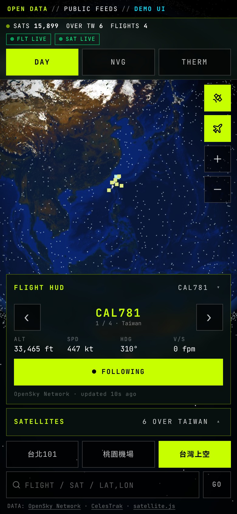

# God's Eye View // ORB-7 🌍🛰️

手機優先的「上帝視角」衛星／航班追蹤地球儀。純前端、不需要 API key，可直接放到 GitHub Pages。
資料來自**公開資料源**（OpenSky Network 航班、CelesTrak 衛星軌道），抓不到時會顯示明顯的橘色 **DEMO DATA** 徽章並改用示範資料。



> ⚠️ 這是一個**展示／學習用**專案：介面風格是虛構的「諜報儀表板」，但**沒有任何機密資料**，也不代表任何真實監控系統。
> 原本畫面上的 `TOP SECRET // NOFORN` 字樣已改為 `OPEN DATA // PUBLIC FEEDS // DEMO UI`。
> 航班與衛星資料為公開、非即時保證（延遲／缺漏／被限流都可能發生），**請勿用於導航或任何安全相關用途**。

## 功能

* 🌐 3D 地球（three.js）：日間 / 夜視 (NVG) / 熱像 (THERM) 三種顯示模式，晝夜交界線依「現在時間」計算
* ✈️ **台灣周邊真實航班**（OpenSky，範圍 21.5–26.5°N、119–123°E）：顯示即時架數；Flight HUD 可 ‹ › 切換航班，顯示呼號、高度 (ft)、速度 (kt)、航向、升降率，並可「FOLLOW」跟隨；每 15 秒更新，兩次更新之間依航向與速度平滑推算
* 🛰️ **真實衛星**（CelesTrak TLE + satellite.js SGP4）：顯示衛星總數、**台灣上空的衛星清單**、ISS 即時位置（可一鍵追蹤）
* 🚢 **台灣周邊船舶 (AIS)**：船形標記（依貨輪／油輪／客輪／漁船／其他／疑似海警上色，與白色飛機標記明顯不同）、「在畫面內 N 艘」計數、‹ › 切換或直接點選船隻、船名／MMSI／船型／航速 (kn)／航向／目的地、FOLLOW 跟隨；資料由自己的 Cloudflare Worker 向 aisstream.io 取得（API key 只存在 Worker secret），沒有 key 或失敗時顯示 **DEMO DATA**
* 🛰️ **過境預測 (Passes)**：用瀏覽器定位（預設台北，也可手動輸入經緯度）預測未來 72 小時 ISS、天宮 (CSS) 與數顆亮星（HST、AJISAI、TERRA、AQUA、ENVISAT、ALOS）的過境：起／峰／止時間、最高仰角、起訖方位、是否「可能看得到」（衛星受日照且天色夠暗）；「LOOK HERE」羅盤會指出現在該看的方位與仰角，可選用手機羅盤；頁面開著時可在過境前 5 分鐘通知
* 🔔 **Web Push 提醒（頁面關閉也會收到）**：台灣周邊 M4.5+ 地震（USGS）、AIS 出現疑似中國海警船、ISS 過境前約 5 分鐘（依訂閱者位置）；每種提醒可分別開關。需先部署 Worker（見 [`proxy/DEPLOY.md`](proxy/DEPLOY.md)）；iOS 16.4+ 須先加入主畫面
* 🔎 搜尋：輸入呼號（如 `CAL`）、船名或 9 位 MMSI、衛星名稱（如 `STARLINK`、`ISS`）或座標（`25.03,121.56`）
* 📍 快速定位：台北101、桃園機場、台灣上空
* 📱 手機優先：375–430 px 直式不會橫向捲動、所有按鈕 ≥ 44 px、HUD 面板可收合（手機上一次只展開一個）、支援瀏海／Home 指示條 safe-area
* 📲 PWA：`manifest.json`、`theme-color`、`apple-mobile-web-app-*`、圖示，可「加入主畫面」；Service Worker 只快取靜態檔，資料 API 一律走網路
* 🧯 容錯：CORS 被擋、網路錯誤、逾時、HTTP 429 都會優雅降級（徽章 + 說明 + 退避重試），衛星 TLE 本地快取 2 小時

## 如何執行

最簡單：用任何靜態伺服器開啟 `index.html`。

```bash
cd gods-eye-mobile
python3 -m http.server 8000      # 或 npx serve .
# 開啟 http://localhost:8000
```

也可以直接雙擊 `index.html`（`file://`）：畫面、貼圖、示範資料都能運作，但瀏覽器可能因為 `file://` 的 origin 為 `null` 而擋掉部分資料請求，此時會顯示 DEMO DATA。

網址參數：`?demo=1` 強制使用示範資料；`?sats=stations` 只載入小型衛星群組（省流量）；`?opensky=https://你的-worker.workers.dev/api` 指定自己的 OpenSky 代理。

### 設定

編輯 `assets/config.js`（不需重新建置）：`openskyBase`、台灣範圍 `bbox`、`flightRefreshMs`、`satGroup`、`satRefreshMs`、`tleCacheMs`、`demoFallback`。

## ⚠️ 關於 OpenSky 與 CORS（請務必閱讀）

* **CelesTrak**：實測 `access-control-allow-origin: *`，瀏覽器可直接呼叫。✅
* **OpenSky**：官方並未承諾對第三方網站開放 CORS，多數情況在 GitHub Pages 上直接呼叫會被瀏覽器擋下（此時 App 自動顯示 DEMO DATA）。匿名使用者每天只有 **400 credits**（本範圍每次 1 credit），15 秒更新約 100 分鐘就用完，之後會 429。
* **建議做法**：部署 [`proxy/cloudflare-worker.js`](proxy/cloudflare-worker.js)（Cloudflare Workers 免費方案即可，加 CORS 標頭並快取 10 秒），然後把 `assets/config.js` 的 `openskyBase` 改成 `https://<你的 worker>.workers.dev/api`。
* 完整測試記錄見 [`docs/DATA-SOURCES.md`](docs/DATA-SOURCES.md)（開發沙盒連不上 OpenSky，所以該端點的即時回應未能親自驗證；開發時用模擬回應測試了解析與 UI）。

## 部署到 GitHub Pages

1. 建立 GitHub repo，把此資料夾內容推上去（`index.html` 在根目錄）。
2. 到 **Settings → Pages**，Source 選 *Deploy from a branch*，Branch 選 `main` / `(root)`。
3. 幾分鐘後即可在 `https://<你的帳號>.github.io/<repo>/` 開啟；手機用 Safari「分享 → 加入主畫面」或 Chrome「安裝應用程式」。
4. 所有路徑皆為相對路徑，子路徑部署不需額外設定。

## 專案結構

```
index.html              入口（viewport / PWA meta）
manifest.json, sw.js    PWA
assets/styles.css       手寫的行動優先樣式（取代原本的 Tailwind 編譯檔）
assets/config.js        執行期設定
assets/live-data.js     OpenSky + CelesTrak 資料層（含 DEMO 退路）
assets/app.bundle.js    ← build.mjs 產生：React + three.js（原 artifact 的 bundle）+ src/app.js
assets/textures.js      ← build.mjs 產生：把 assets/textures/*.jpg 內嵌成 data URI（讓 file:// 也能用）
assets/textures/        NASA Blue Marble / Black Marble 貼圖
assets/vendor/          satellite.js 6.0.2（MIT）
src/vendor.js           從原 artifact 抽出的 React / three.js / lucide 壓縮碼
src/app.js              可讀的應用程式原始碼（已重寫）
proxy/                  Cloudflare Worker：OpenSky CORS 代理、AIS 船舶中繼、Web Push（src/ 原始碼、dist/ 部署檔、DEPLOY.md）
assets/passes.js        衛星過境預測核心（瀏覽器與 Worker 共用）
assets/push.js          Web Push 前端
scripts/gen-vapid.mjs   產生 VAPID 金鑰
```

修改 `src/app.js` 後執行 `node build.mjs`（無需 npm 套件）重新產生 `assets/app.bundle.js`。

### 關於「原始碼還原」

原本是已打包的 React artifact（單一 HTML）。React／three.js 的原始碼無法乾淨還原（已壓縮、變數名被改寫），所以保留 `src/vendor.js` 這份打包碼；但應用程式本身（約 800 行）已改寫成可讀的 `src/app.js`，並移除了 artifact 平台注入的 `window.parent.postMessage` 程式、`/fonts/...` 絕對路徑字型與 Google Fonts `@import`（改用系統等寬字型）。

## 致謝 / Credits

* 航班資料：[OpenSky Network](https://opensky-network.org)（Schäfer et al., IPSN 2014）
* 衛星軌道資料：[CelesTrak](https://celestrak.org)（Dr. T.S. Kelso）
* SGP4：[satellite.js](https://github.com/shashwatak/satellite-js)（MIT）
* 地球貼圖：NASA Earth Observatory — Blue Marble Next Generation、Black Marble
* [three.js](https://threejs.org)、[React](https://react.dev)、[lucide](https://lucide.dev)（皆 MIT）

## 授權

MIT © 2026 messiah — 見 [LICENSE](LICENSE)。第三方資料與素材請遵守各自條款。

---

## English summary

**God's Eye View // ORB-7** is a mobile-first, client-side-only 3D globe that shows **real public data** around Taiwan: live flights from the [OpenSky Network](https://opensky-network.org) REST API and satellites propagated in the browser from [CelesTrak](https://celestrak.org) TLEs with [satellite.js](https://github.com/shashwatak/satellite-js) (real satellite count, satellites currently over Taiwan, ISS position). It has DAY / NVG / THERM modes, a flight HUD you can cycle through real aircraft, search, camera follow, safe-area aware responsive layout, and PWA basics (installable).

* **Run:** serve the folder with any static server (`python3 -m http.server`) and open `index.html`; no build or API key needed. `node build.mjs` only if you edit `src/app.js`.
* **Deploy:** push to GitHub, enable *Settings → Pages → main / root*. All paths are relative.
* **Data caveats:** CelesTrak sends `Access-Control-Allow-Origin: *`; OpenSky does **not** reliably allow third-party origins and anonymous access is limited to ~400 credits/day. If a feed fails (CORS, 429, timeout) the UI shows an amber **DEMO DATA** badge and generated placeholder data. For reliable flight data deploy `proxy/cloudflare-worker.js` and set `openskyBase` in `assets/config.js`.
* **Disclaimer:** the "spy dashboard" look is purely fictional styling. The original fake `TOP SECRET // NOFORN` banner was replaced with `OPEN DATA`. Data is public, best-effort and unverified — not for navigation or safety-critical use. Demo data is generated randomly.
* **License:** MIT © 2026 messiah. Data sources: OpenSky Network, CelesTrak; textures: NASA Earth Observatory.
